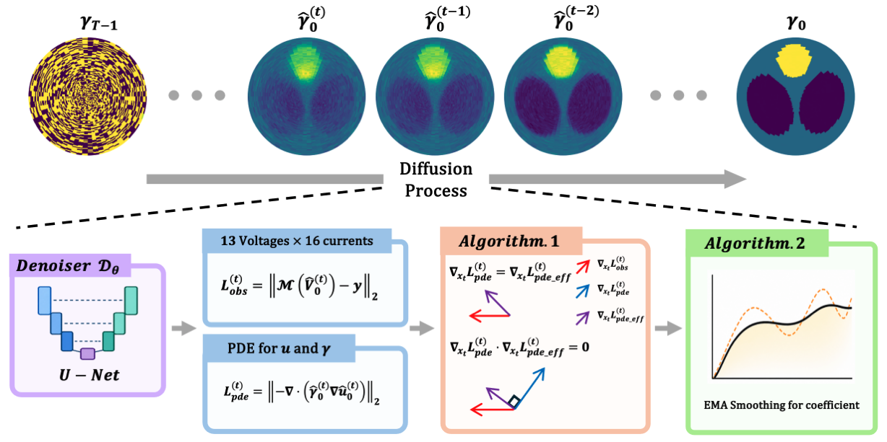

# Diffusion models with Adaptive Guidance for 16-electrode Electrical Impedance Tomography (DAG-EIT)

Implementation of DAG-EIT in PyTorch.

<p align="center">
  
</p>

## Installation

Clone the repository and move to the project directory:

```bash
git clone <current url>
cd DAG-EIT
```

Create the Conda environment using the provided `environment.yml` file:

```bash
conda env create -f environment.yml
```

Activate the environment:

```bash
conda activate DAG-EIT
```

To verify that PyTorch and CUDA are available, run:

```bash
python -c "import torch; print('PyTorch version:', torch.__version__); print('CUDA available:', torch.cuda.is_available())"
```

## Data and Pretrained Model

The datasets and pretrained model can be downloaded from the following links:

| Resource                          | Download Link                                                                                |
| --------------------------------- | -------------------------------------------------------------------------------------------- |
| Training Data                     | [Google Drive](https://drive.google.com/drive/u/1/folders/1RhCpl-4NO5A7RrFZKTs8qTu-KTnFOK7G) |
| Validation Data                   | [Google Drive](https://drive.google.com/drive/u/1/folders/1RDHtIZqbJ7g4dL2OLuwSrIane7szs0HV) |
| Test Data                         | [Google Drive](https://drive.google.com/drive/u/1/folders/1XTmjayfwp1qoWfiSRb9Cloz0lhCmis0t) |
| Pretrained Model                  | [Google Drive](https://drive.google.com/drive/u/1/folders/1JhZpD5UeDLqXD7PKXc8krLSUHiWDJwec) |
| All Datasets and Pretrained Model | [Google Drive](https://drive.google.com/drive/u/1/folders/1vUKcP0t2PN6vAJIxSTbym4V4p3d0nYQM) |

Place the downloaded training and validation files in the following directories:

```text
DAG-EIT/
├── data/
│   ├── training/
│   │   ├── eit_train_0326_original.pt
│   │   ├── eit_train_0326_obesity1.pt
│   │   ├── eit_train_0326_obesity2.pt
│   │   └── eit_train_0326_ellipse.pt
│   ├── validation/
│   │   └── eit_valid_0326.pt
│   └── testing/
│       └── eit_test_0326.pt
└── pretrained/best_model.pkl
```

Before sampling, update the test-data path and pretrained-model path in `configs/eit.yaml`.

## Training

Set `YOUR_DEVICE_NUMBER` to the GPU device number to use. For example, use `DEVICE=0` for the first GPU.

```bash
DEVICE=YOUR_DEVICE_NUMBER

nohup bash -c "CUDA_VISIBLE_DEVICES=${DEVICE} python train.py \
  --outdir=./pretrained \
  --data=./data/training/eit_train_0326_original.pt,./data/training/eit_train_0326_obesity1.pt,./data/training/eit_train_0326_obesity2.pt,./data/training/eit_train_0326_ellipse.pt \
  --train-mix-ratio=2,1,1,1 \
  --valid-data=./data/validation/eit_valid_0326.pt \
  --cond=0 --arch=ddpmpp \
  --batch=100 --batch-gpu=100 \
  --tick=10 --snap=100 --dump=500 --duration=30 --ema=0.05 \
  --lr=1e-4" \
  > eit_train.txt 2>&1 &
```

The training process runs in the background with `nohup`, and the output is written to `eit_train.txt`.

To monitor the training log, run:

```bash
tail -f eit_train.txt
```

## Sampling

Configure the test dataset, pretrained model, and GPU device in `configs/eit.yaml`, and then run:

```bash
python generate_eit.py --config configs/eit.yaml
```

## Citation

::: 
